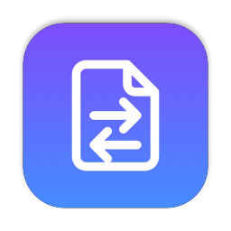
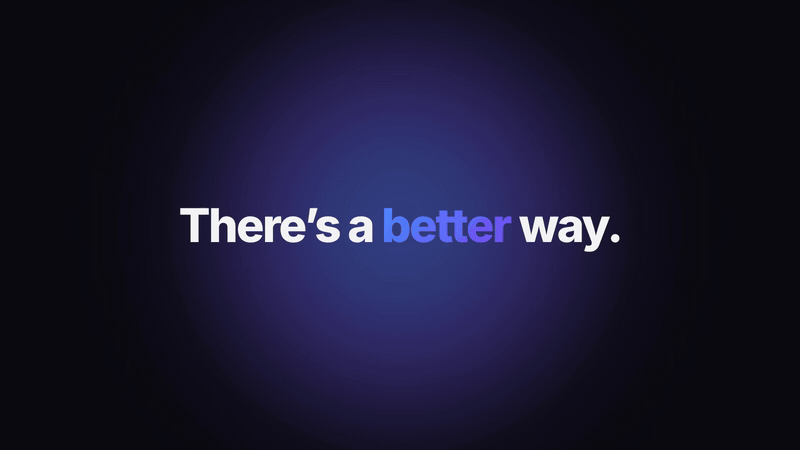
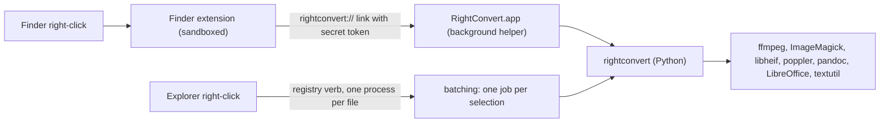

<p align="center"></p>

<h1 align="center">RightConvert</h1>

<p align="center">Right-click any file on your Mac or PC, hover <b>Convert</b>, pick a format. Done.</p>

<p align="center">
  <a href="https://github.com/pelegino/rightconvert/releases/latest"></a>
  <a href="https://github.com/pelegino/rightconvert/actions/workflows/test.yml"></a>
  
  <a href="LICENSE"></a>
</p>

<p align="center"><a href="https://github.com/pelegino/rightconvert/releases/download/v1.0.0/rightconvert-launch-16x9.mp4"></a></p>

<p align="center"><a href="https://github.com/pelegino/rightconvert/releases/download/v1.0.0/rightconvert-launch-16x9.mp4">Watch the 20-second video</a></p>

RightConvert adds a **Convert** submenu to Finder and Windows Explorer that turns images, video, audio, PDFs, and documents into other formats. The converted file is saved next to the original, and the original is never touched or overwritten.

- **100% local.** Your files never leave your computer. Conversions run with ffmpeg, ImageMagick, libheif, poppler, pandoc, LibreOffice, and (on macOS) the built-in `textutil`.
- **No quality loss where the format allows it.** Lossless targets come out bit-exact, and container changes copy streams instead of re-encoding. See [Quality](#quality).
- **Only valid choices.** The submenu lists only the formats your selected files can actually become with the tools you have installed.

## Install on macOS

Requirements: macOS 13 or later, [Homebrew](https://brew.sh), and Xcode or the Command Line Tools (`xcode-select --install`).

Clone the repository (or download the source code from the [latest release](https://github.com/pelegino/rightconvert/releases/latest)) and run the installer:

```sh
git clone https://github.com/pelegino/rightconvert.git
cd rightconvert
./install.sh
```

The installer:

1. Installs the conversion tools with Homebrew: `ffmpeg`, `imagemagick`, `libheif`, `poppler`, `pandoc`.
2. Asks whether to install LibreOffice (about 1 GB). It's needed for Word, Excel, and PowerPoint formats and for converting documents to PDF.
3. Builds `RightConvert.app` from source, installs it to `~/Applications`, and enables its Finder extension.
4. Links the `rightconvert` command into `~/.local/bin`.

Options: `--with-libreoffice`, `--no-libreoffice`, and `--skip-deps` (rebuild and reinstall only the app and CLI).

If **Convert** doesn't appear in the right-click menu, open System Settings > General > Login Items & Extensions, click the info button next to **Finder**, turn on **RightConvert**, and run `killall Finder`.

To remove it, run `./uninstall.sh`. The Homebrew packages stay installed.

## Install on Windows

Requirements: Windows 10 or 11 with [winget](https://learn.microsoft.com/windows/package-manager/winget/) (preinstalled on current versions as "App Installer").

Download the source code ZIP from the [latest release](https://github.com/pelegino/rightconvert/releases/latest), unzip it, and double-click `windows\install.cmd`. If SmartScreen warns about it, click **More info**, then **Run anyway**. From a terminal, the same thing is:

```powershell
git clone https://github.com/pelegino/rightconvert.git
cd rightconvert
powershell -ExecutionPolicy Bypass -File windows\install.ps1
```

The installer:

1. Installs the conversion tools with winget: FFmpeg, ImageMagick, Poppler, Pandoc, and Python if you don't have 3.9 or later.
2. Asks whether to install LibreOffice (about 1 GB), for the same formats as on macOS.
3. Copies RightConvert to `%LOCALAPPDATA%\RightConvert` and adds the **Convert** submenu to Explorer for your user account. No administrator rights are needed for this step.
4. Adds the `rightconvert` command to your PATH.

Options: `-WithLibreOffice`, `-NoLibreOffice`, and `-SkipDeps` (reinstall only RightConvert and refresh the menu).

On Windows 11, **Convert** is in the classic menu: click **Show more options**, or Shift+right-click the file.

Once installed, you can delete the downloaded folder. To remove RightConvert, double-click `uninstall.cmd` in `%LOCALAPPDATA%\RightConvert\windows` (or in the download). The winget packages stay installed.

## Usage

**In Finder or Explorer:** select one or more files, right-click, hover **Convert**, and click a format.

- With several files selected, the submenu shows only formats they can all be converted to.
- On folders, **Convert...** opens a format picker and converts the files inside. It goes one level deep and skips hidden files.
- A notification tells you when the conversion is done. If something fails, a dialog names the file and points to the log.

**In a terminal:**

```sh
rightconvert photo.heic                    # opens the format picker
rightconvert --to mp3 talk.mov more/       # no picker
rightconvert --to webp-small photo.jpg     # smaller lossy file instead of lossless
rightconvert --list report.docx            # formats this file can become
```

Output goes next to each source file. If `photo.jpg` already exists, the new file is saved as `photo-1.jpg`, then `photo-2.jpg`, and so on.

## Supported formats

| From | To | Tool |
| --- | --- | --- |
| Images: jpg, png, heic, webp, gif, tiff, bmp, avif, svg | jpg, png, webp, heic, avif, tiff, gif, bmp, ico, pdf | ImageMagick, libheif |
| Video: mp4, mov, mkv, avi, webm, m4v | mp4, mov, mkv, webm, animated gif, or audio only (mp3, m4a, wav) | ffmpeg |
| Audio: mp3, wav, m4a, aac, flac, ogg, opus, aiff | mp3, wav, m4a, flac, ogg, opus, aiff | ffmpeg |
| PDF | png or jpg (one image per page, in a `name-pages` folder), txt, docx | poppler, LibreOffice |
| Documents: docx, doc, odt, rtf, txt, md, html | pdf, docx, doc, odt, rtf, txt, md, html | pandoc, LibreOffice, `textutil` |
| Spreadsheets: xlsx, xls, ods, csv | xlsx, xls, ods, csv, pdf | LibreOffice |
| Presentations: pptx, ppt, odp | pptx, ppt, odp, pdf | LibreOffice |

If a tool isn't installed, the formats that need it are left out of the menu. After installing one later, run the installer again with `--skip-deps` (macOS) or `-SkipDeps` (Windows) to refresh the menu.

Platform differences:

- **macOS** converts among doc, docx, odt, rtf, txt, and html with no installs at all, using `textutil`. On Windows these need pandoc or LibreOffice.
- **Windows** has no lossless HEIC or AVIF encoder in winget, so those two appear only as **AVIF (smaller file)**, when ImageMagick can write AVIF. If `heif-enc` from libheif is on your PATH (for example from MSYS2), the lossless versions appear too. HEIC files can still be converted *from* on Windows.

## Quality

Conversions never lose more than the target format forces them to. `tests/test_quality.py` measures each of these guarantees.

**Bit-exact:**

- PNG, TIFF, BMP, WebP, HEIC, and AVIF are encoded losslessly, even from a JPEG source, so the output has exactly the input's pixels. Lossless HEIC and AVIF are only offered when `heif-enc` is installed, so the menu never offers a "lossless" option that would quietly be lossy.
- FLAC, WAV, AIFF, and M4A (as Apple Lossless, when the source is lossless) keep every sample, plus the source's bit depth and sample rate. 24-bit/96 kHz stays 24-bit/96 kHz.
- When the target container can hold the original streams, they're copied byte for byte. That covers MP4 to MOV, anything to MKV, HEVC to MP4, AAC from a video to M4A, and MP3 audio to `.mp3`. Subtitles are kept when converting to MKV, and cover art is kept for MP3, M4A, and FLAC.

**Transparent when re-encoding is unavoidable:**

- Video uses H.264 at CRF 16, 10-bit HEVC for 10-bit/HDR sources, and VP9 at CRF 12 for WebM. These score at least 0.99 SSIM against the source. Odd-sized video is cropped by one pixel rather than rescaled.
- Audio uses MP3 at 320 kbps, AAC at 320 kbps, and Opus at 256 kbps.
- JPG uses quality 95 with full 4:4:4 color, and PDF pages render at 300 dpi.

**Smaller file.** Lossless images can be much larger than a JPEG original. WebP, HEIC, and AVIF each also appear as **(smaller file)**: a lossy encode that's typically 2 to 4 times smaller than the source JPEG and still above 40 dB PSNR.

**Unavoidable losses:**

- JPG, MP3, AAC, Opus/OGG, re-encoded video, and the smaller-file options are lossy by design.
- GIF holds at most 256 colors, and ICO at most 256x256 pixels.
- Converting a lossy file to a lossless format doesn't restore what was already lost.
- Document conversions keep only the formatting the target supports.
- Photo metadata such as EXIF isn't guaranteed to carry over to every format.

## How it works

Both platforms share one converter, the `rightconvert` Python package. It uses only the standard library and runs on Python 3.9 or later.



- `rightconvert/`: does every conversion. `formats.py` holds the format table, `engines.py` finds the installed tools and picks one for each conversion, and `media.py` and `documents.py` run them. `bin/rightconvert` is the command-line launcher.
- **macOS:** `app/FinderSync/` is the Finder Sync extension that builds the **Convert** menu. Because it's sandboxed, it can't run converters itself. It reads the format table at `~/Library/Application Support/rightconvert/matrix.txt` and hands the selection to `app/Host/`, a background helper app with no Dock icon. The helper runs the converter with the system Python, and only acts on requests carrying a random token stored next to the table, which other apps and web pages can't read.
- **Windows:** `rightconvert --register` writes a classic cascading menu for each supported extension under `HKEY_CURRENT_USER\Software\Classes`. Explorer starts one process per selected file, so `rightconvert/batch.py` gathers them into a single job, which gives you one picker and one notification for the whole selection.

## Troubleshooting

- **Convert doesn't appear in the menu.** On macOS, enable **RightConvert** under System Settings > General > Login Items & Extensions > Finder, then run `killall Finder`. On Windows 11, look under **Show more options**.
- **A format you expect is missing.** Its tool probably isn't installed. Install it, then run the installer again with `--skip-deps` or `-SkipDeps`.
- **A conversion failed.** Every command and its error output are logged to `~/Library/Logs/rightconvert.log` on macOS and `%LOCALAPPDATA%\RightConvert\rightconvert.log` on Windows.
- **No notifications appear on macOS.** The first time, macOS may ask you to allow notifications from Script Editor, which is how notifications are shown. Allow them in System Settings > Notifications.
- **`brew install` fails with "You have not agreed to the Xcode license".** Run `sudo xcodebuild -license accept`, then run `./install.sh` again.

## Contributing

Bug reports, format requests, and pull requests are welcome. See [CONTRIBUTING.md](CONTRIBUTING.md) for setup and tests, and the [code of conduct](CODE_OF_CONDUCT.md). Report security problems privately as described in [SECURITY.md](SECURITY.md). Changes between versions are in the [changelog](CHANGELOG.md).

## License

[MIT](LICENSE)
